# DapurStock - Dashboard Pemantau Harga dan Stok untuk UMKM Kue Kering

Mini Project Front-End, Ujian Tengah Semester Pemrograman Web (26TJ453127)

## 1. Identitas

| | |
|---|---|
| Nama | Yuliana Octavianti |
| NPM | 2440304033 |
| Kelas | A1_TEKOM_24 |
| Program Studi | Teknik Komputer, Universitas Borneo Tarakan |

## 2. Tentang Aplikasi

**DapurStock** adalah dashboard sederhana untuk membantu pemilik UMKM kue kering rumahan memantau harga dan stok bahan serta peralatan dapur. Pengguna dapat memilih kategori yang ingin dipantau, mencari produk, dan melihat ringkasan harga.

Data produk berasal dari **DummyJSON** sebagai data contoh, bukan data asli UMKM. DummyJSON tidak memiliki produk khusus kue, sehingga aplikasi menyaring data (daftar `BAHAN_KUE` di `js/app.js`) agar hanya bahan dan peralatan yang relevan untuk usaha kue kering yang ditampilkan.

## 3. Perhitungan Varian NIM

Tiga digit terakhir NPM: **033**, sehingga X = 0, Y = 3, Z = 3.

| Komponen | Digit | Hasil |
|---|---|---|
| Dataset | X = 0 | Products (`https://dummyjson.com/products`) |
| Fitur utama | Y = 3 | Pagination + pilihan jumlah data per halaman |
| Validasi form | Z = 3 | Minimal satu kategori/preferensi dipilih |
| Challenge | S = 0 + 3 + 3 = 6, C = 6 mod 4 = 2 | Loading indicator + pencarian dengan debounce |

## 4. Dataset dan REST API

- **Endpoint:** `GET https://dummyjson.com/products?limit=0`
- **Method:** GET, tanpa autentikasi
- **Parameter `limit=0`:** meminta semua produk sekaligus (194 produk)
- **Bentuk respons:** `{ "products": [...], "total": 194, "skip": 0, "limit": 194 }`
- **Field yang dipakai:** `title`, `price`, `category`, `stock`, `thumbnail`

Contoh satu produk:

```json
{
  "id": 1,
  "title": "Eggs",
  "category": "groceries",
  "price": 2.99,
  "stock": 100,
  "thumbnail": "https://cdn.dummyjson.com/..."
}
```

## 5. Fitur Utama dan Challenge

- **Fetch API dengan async/await**, pemeriksaan `response.ok`, dan `try...catch...finally`.
- **Tiga kondisi tampilan:** loading (spinner), sukses (pesan hijau), error (pesan merah).
- **Render DOM** memakai `createElement` dan `textContent` (tanpa `innerHTML` untuk data API).
- **Analisis data** dihitung JavaScript: rata-rata harga, produk termahal, dan jumlah kategori.
- **Fitur Y (pagination):** tombol Sebelumnya/Berikutnya, info halaman, dan pilihan 5/10/20 data per halaman.
- **Validasi Z:** minimal satu kategori harus dipilih, dengan pesan error berupa teks. Input tidak valid tidak diproses.
- **Challenge C:** loading indicator dan pencarian dengan debounce 400 ms.
- **localStorage:** pilihan kategori tersimpan dan dimuat saat halaman dibuka.
- **Responsif:** 1 kolom (mobile), 2 kolom (tablet, mulai 600 px), 4 kolom (desktop, mulai 1024 px).
- **Aksesibilitas:** `label` terhubung ke input, `alt` pada gambar, `aria-live` untuk status, `:focus-visible`.
- Hanya memakai **HTML, CSS, dan JavaScript murni** (tanpa framework atau library).

## 6. Cara Menjalankan

1. Clone atau unduh repository ini.
2. Letakkan folder di web root server lokal (misalnya `C:\laragon\www\`), lalu jalankan Laragon (Start All).
3. Buka `http://localhost/pts-pemweb-2440304033/` di browser.
4. Perlu koneksi internet karena data diambil dari DummyJSON.

Script bertipe module tidak berjalan jika `index.html` dibuka langsung lewat `file://`, jadi gunakan server lokal.

## 7. Screenshot

| Tampilan | Gambar |
|---|---|
| Desktop | 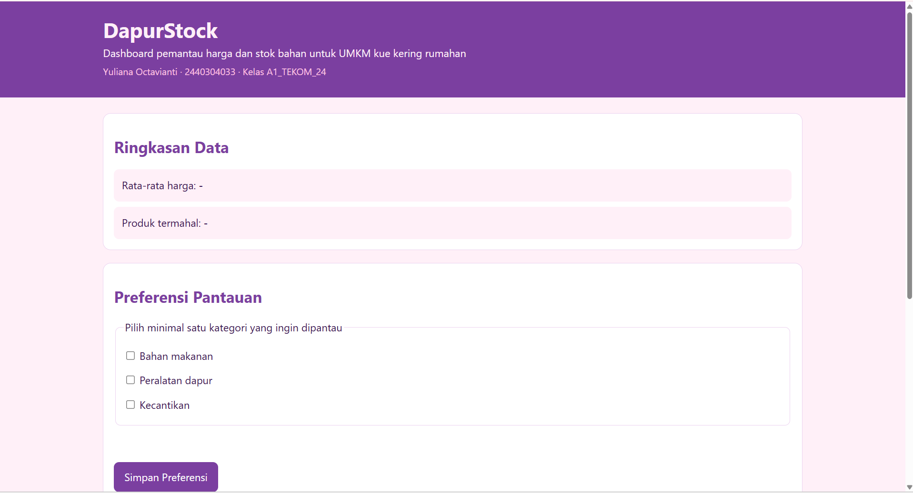 |
| Laptop 1024 px | 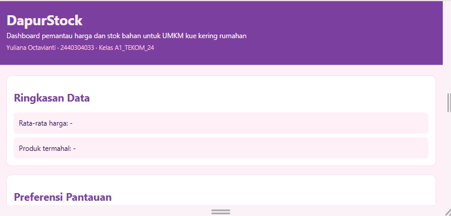 |
| Tablet 768 px | 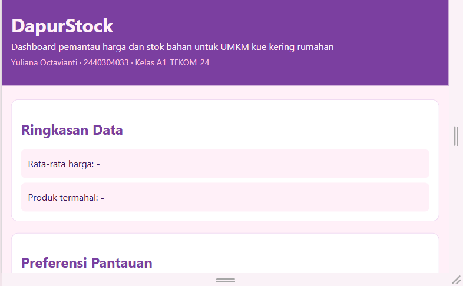 |
| Mobile 480 px | 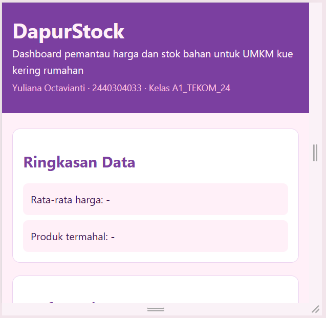 |
| Mobile 320 px | 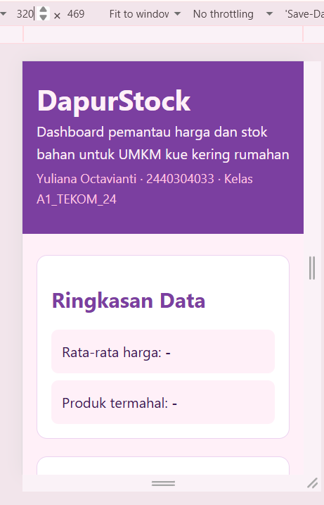 |
| Fokus keyboard | 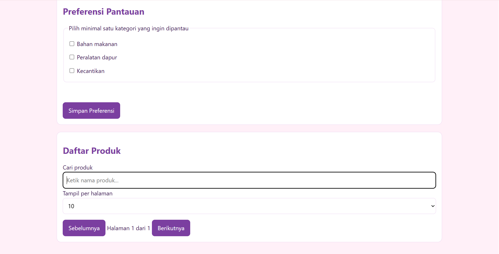 |
| Request API di DevTools Network | 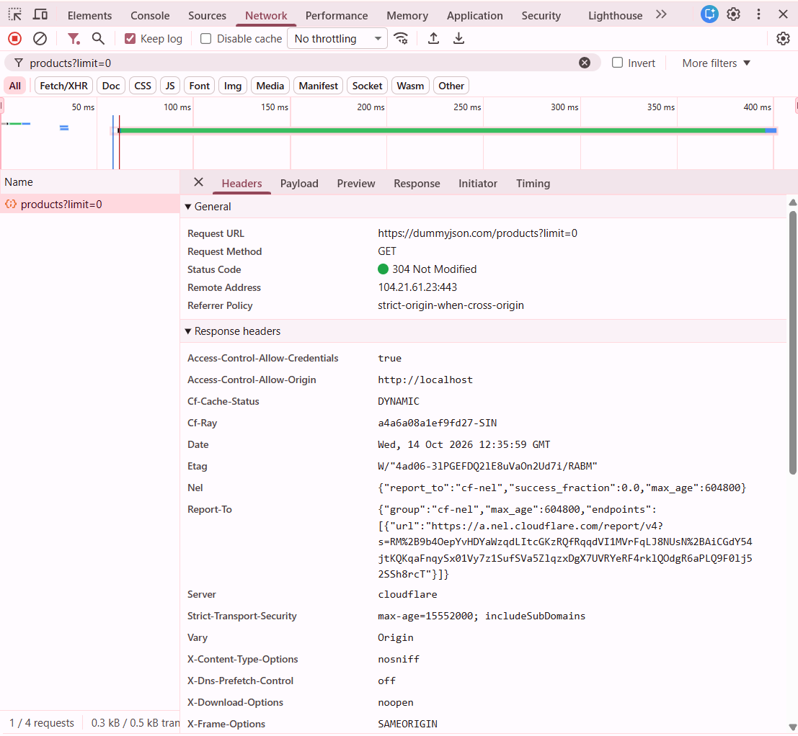 |
| Kondisi loading | 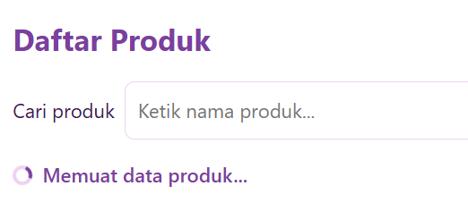 |
| Kondisi sukses | 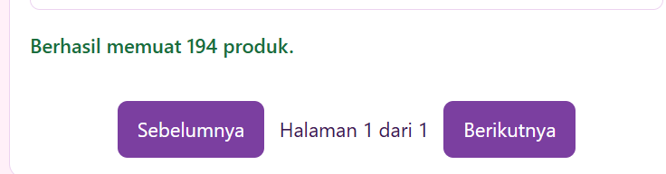 |
| Kondisi error | 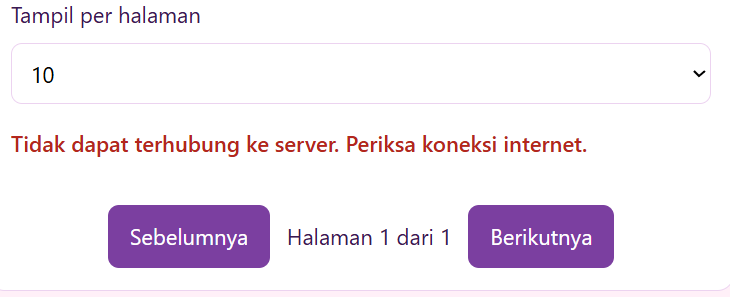 |
| Kartu produk dan ringkasan | 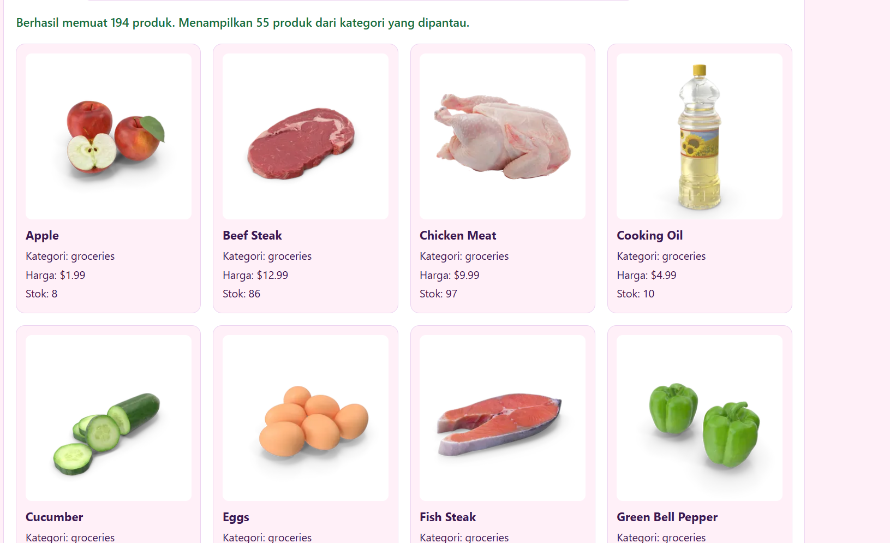 |
| Pagination | 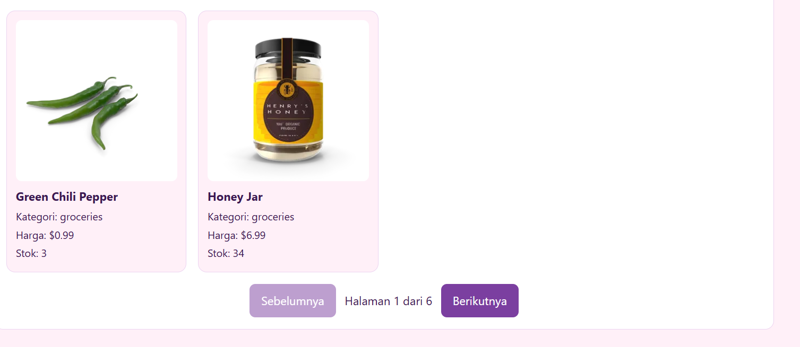 |
| Pencarian | 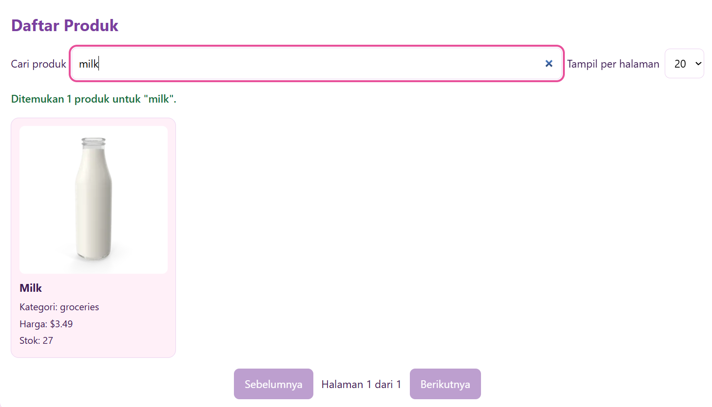 |
| Pencarian tanpa hasil | 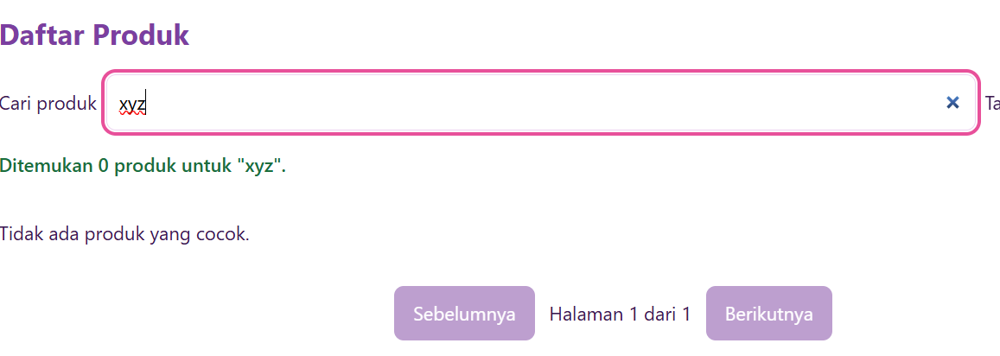 |
| Validasi gagal | 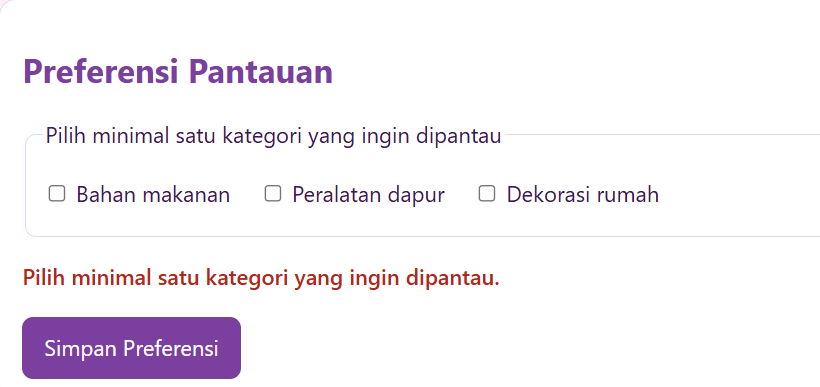 |
| Validasi berhasil | 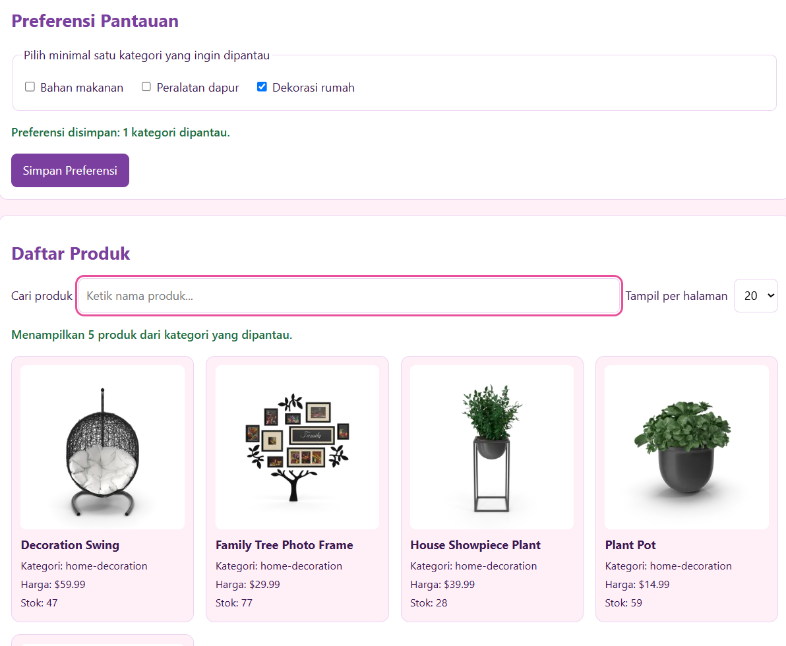 |

## 8. Struktur Proyek

```
pts-pemweb-2440304033/
├── index.html
├── css/style.css
├── js/app.js
├── screenshots/
└── README.md
```

## 9. Jawaban 10 Pertanyaan Penjelasan Kode

**1. Alur dari halaman dibuka sampai data tampil.**
Browser memuat `index.html`, lalu `js/app.js` sebagai module. Di awal file, elemen DOM diambil dengan `querySelector`, state diisi nilai awal, dan semua event listener dipasang. Di baris paling bawah, `muatPreferensi()` membaca pilihan kategori dari localStorage, lalu `loadData()` dijalankan. `loadData()` menyalakan loading lewat `aturLoading(true)`, memanggil `fetch(API_URL)`, memeriksa `response.ok`, mengubah isi respons dengan `response.json()`, dan menyimpan `data.products` ke `semuaProduk`. Setelah itu `tampilkanHalaman()` memanggil `ambilProdukTampil()` untuk menyaring data, memotongnya sesuai halaman, lalu `renderProduk()` dan `tampilkanRingkasan()` menampilkan hasilnya. Terakhir, blok `finally` mematikan loading.

**2. Mengapa `response.ok` tetap diperiksa setelah `fetch()`.**
`fetch()` hanya menolak (reject) kalau jaringan gagal, misalnya internet putus. Kalau server menjawab 404 atau 500, `fetch()` tetap dianggap berhasil dan mengembalikan `response`. Properti `response.ok` bernilai `false` untuk status di luar 200-299. Tanpa pemeriksaan itu, kode akan lanjut memproses halaman error seolah-olah data valid dan bisa menampilkan hasil yang salah atau error yang membingungkan. Karena itu saya periksa `response.ok` dan melempar `Error` dengan kode status.

**3. Satu data JSON diubah menjadi elemen DOM.**
Fungsi `buatKartu(produk)` menerima satu objek produk, misalnya `{ title: "Eggs", price: 2.99, ... }`. Fungsi ini membuat elemen `<article class="card">` dengan `createElement`, lalu `` (diisi `src` dari `thumbnail` dan `alt` dari `title`), `<h3>` untuk nama, dan beberapa `<p>` untuk kategori, harga, dan stok. Teks diisi dengan `textContent` sehingga data dari API tidak pernah dianggap sebagai HTML (lebih aman daripada `innerHTML`). Semua elemen digabung dengan `kartu.append(...)` dan dikembalikan, lalu `renderProduk()` memasukkan seluruh kartu ke `#daftar-produk`.

**4. Penanganan internet putus, endpoint salah, HTTP 404/500.**
Semua kegagalan ditangkap oleh satu blok `try...catch` di `loadData()`.
- **Internet putus:** `fetch()` melempar `TypeError`, sehingga pesan yang tampil: "Tidak dapat terhubung ke server. Periksa koneksi internet."
- **Endpoint salah atau HTTP 404/500:** `fetch()` berhasil tapi `response.ok` bernilai `false`, jadi kode melempar `Error` dengan kode status. Pesan yang tampil: "Gagal memuat data: Server menjawab dengan kode 404".
- Blok `finally` selalu mematikan loading, sehingga spinner tidak tertinggal. Error juga dicatat dengan `console.error` untuk keperluan debugging.

**5. Cara kerja pagination.**
State `halamanSaatIni` dan `perHalaman` menyimpan posisi dan jumlah data per halaman. Fungsi `tampilkanHalaman()` menghitung `totalHalaman = ceil(jumlah data / perHalaman)`, indeks awal `(halamanSaatIni - 1) * perHalaman`, lalu mengambil potongan data dengan `slice`. Tombol dinonaktifkan lewat properti `disabled` di halaman pertama dan terakhir. Event yang dipakai: `click` pada tombol Sebelumnya dan Berikutnya (mengubah `halamanSaatIni`), dan `change` pada dropdown (mengubah `perHalaman` dan mengembalikan ke halaman 1). Setiap perubahan memanggil `tampilkanHalaman()` yang sama.

**6. Cara kerja validasi dan alasan input tidak valid tidak diproses.**
Form memakai `novalidate`, sehingga validasi ditulis sendiri di event `submit`. Pertama, `event.preventDefault()` mencegah halaman dimuat ulang. Lalu kategori yang dicentang dikumpulkan dengan selector `:checked`. Kalau jumlahnya nol, pesan error berupa teks ditampilkan di `#pesan-form` (dengan `role="alert"`), fokus dipindah ke checkbox pertama, dan fungsi berhenti dengan `return`. Dengan begitu `kategoriAktif` tidak berubah, daftar tidak diperbarui, dan tidak ada yang disimpan ke localStorage. Input tidak valid tidak diproses supaya dashboard tidak menjadi kosong tanpa alasan dan data yang tidak bermakna tidak tersimpan.

**7. Penggunaan localStorage.**
Pilihan kategori disimpan dengan kunci `dapurstock-kategori` dalam bentuk array JSON (`JSON.stringify`). Penyimpanan terjadi di `simpanPreferensi()` setiap kali form valid disimpan. Saat halaman dibuka, `muatPreferensi()` membaca nilainya dengan `JSON.parse`, mencocokkannya dengan kategori yang valid di form, lalu mengatur ulang checkbox dan `kategoriAktif`. Semua dibungkus `try...catch` karena penyimpanan bisa gagal atau isinya bisa rusak (misalnya saat saya menguji dengan nilai kosong, aplikasi hanya mencatat peringatan dan tetap berjalan dengan kategori bawaan). Manfaatnya, pilihan pengguna tetap ada setelah halaman dimuat ulang. Keterbatasannya: data hanya tersimpan di browser dan origin yang sama, dan hanya berupa teks.

**8. Satu fungsi penting: `tampilkanHalaman()`.**

```js
function tampilkanHalaman() {
  const daftar = ambilProdukTampil();
  const totalHalaman = Math.max(1, Math.ceil(daftar.length / perHalaman));
  if (halamanSaatIni > totalHalaman) { halamanSaatIni = totalHalaman; }
  const mulai = (halamanSaatIni - 1) * perHalaman;
  const potongan = daftar.slice(mulai, mulai + perHalaman);
  renderProduk(potongan);
  tampilkanRingkasan(daftar);
  infoHalamanEl.textContent = `Halaman ${halamanSaatIni} dari ${totalHalaman}`;
  prevEl.disabled = halamanSaatIni <= 1;
  nextEl.disabled = halamanSaatIni >= totalHalaman;
}
```

- **Input:** state `halamanSaatIni`, `perHalaman`, dan daftar produk hasil filter (`ambilProdukTampil()`).
- **Proses:** menghitung total halaman, memastikan halaman saat ini tidak melebihi total, menghitung indeks awal, lalu memotong data dengan `slice`.
- **Output:** kartu produk untuk halaman itu, ringkasan data, teks info halaman, serta status tombol Sebelumnya dan Berikutnya.

**9. Bug paling sulit.**
Setelah menambahkan fitur pencarian dan validasi, halaman tidak menampilkan produk sama sekali, dan saat form disimpan, alamat browser berubah menjadi `?kategori=...`. Penyebabnya, file `app.js` yang tersimpan terpotong akibat proses salin-tempel sehingga kodenya tidak lengkap. Saya menemukannya dengan membuka tab Console di DevTools yang menampilkan `SyntaxError: Unexpected end of input (at app.js:217)`, dan petunjuk dari alamat berubah menandakan event `submit` tidak aktif karena seluruh script gagal dimuat. Saya memperbaikinya dengan mengganti file dengan versi utuh, lalu memastikan baris terakhir file adalah `loadData();` dan Console bersih dari error.

**10. Dua perbaikan teknis jika ada waktu seminggu lagi.**
1. **Pagination di sisi server:** memakai parameter `limit` dan `skip` dari DummyJSON agar hanya data satu halaman yang diambil, bukan 194 produk sekaligus. Ini lebih hemat data untuk dataset besar.
2. **Penanganan error yang lebih lengkap:** menambah batas waktu (`AbortController`) dan tombol "Coba lagi" saat gagal memuat, serta menambah pengujian otomatis untuk fungsi seperti `ambilProdukTampil()` dan perhitungan halaman.

## 10. AI Usage Log

Log ini mencatat penggunaan AI secara jujur. Isi bagian "Yang saya lakukan sendiri" harus sesuai kenyataan.

| No | Tanggal | Alat | Tujuan | Yang saya lakukan sendiri |
|---|---|---|---|---|
| 1 | 14 Okt 2026 | Claude | Menghitung varian NIM dan menyusun tahapan serta ceklis PTS | Memeriksa hasil hitungan, memilih tema DapurStock, dan menentukan nama aplikasi |
| 2 | 14 Okt 2026 | Claude | Penjelasan konsep dan contoh kode struktur HTML dan CSS responsif | Mengetik ulang kode, memilih palet warna ungu-pink, mengubah teks dan label, serta menguji di 320 sampai 1024 px |
| 3 | 14 Okt 2026 | Claude | Penjelasan konsep dan contoh kode Fetch API, async/await, `response.ok`, dan state loading/sukses/error | Menjalankan kode, menguji kondisi loading dan error lewat DevTools, memisahkan elemen loading di HTML, dan menambah statistik jumlah kategori |
| 4 | 15 Okt 2026 | Claude | Penjelasan konsep dan contoh kode render DOM, pagination, pencarian debounce, validasi, dan localStorage | Mengetik dan menguji tiap fitur, menyesuaikan kategori produk dengan konteks kue kering, dan memilih kategori "Dekorasi rumah" |
| 5 | 15 Okt 2026 | Claude | Diagnosis error: file `app.js` terpotong (`SyntaxError`), `kataKunci` belum didefinisikan, kode tertukar tempat | Membaca pesan error di Console, mengirim kode untuk diperiksa, dan menerapkan perbaikan |
| 6 | 15 Okt 2026 | Claude | Menyusun draf README dan skrip video demo | Membaca dan memahami isi, menyesuaikan jawaban dengan kode saya sendiri, dan merekam video |

Saya memahami seluruh kode yang dikumpulkan dan bersedia menjelaskannya saat sesi defense.

## 11. Repository dan Video

- Repository GitHub: `https://github.com/Yulianaoctavianti/pts-pemweb-2440304033`
- Tag rilis: `v0.1-PTS`
- Video demo: **[ISI LINK VIDEO DI SINI]**
